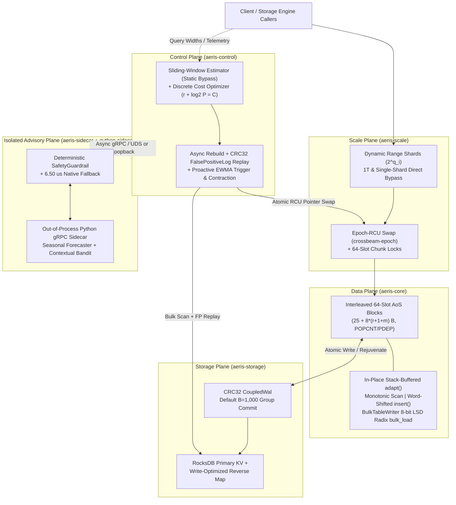

# Aeris-Based Optimized Range Filtering System

A clean-room Rust and Python systems implementation and production extension of the **Aeris Filter** (*Chesetti et al., SIGMOD 2026*), pairing a cache-aligned 64-slot AoS Data Plane with crash-consistent WAL-coupled RocksDB storage, a Dynamic-$R$ + proactive contraction Control Plane, an epoch-RCU range-sharded Scale Plane, and an out-of-process gRPC ML/RL advisory sidecar.

Across **48 bare-metal sequential parity runs** up to **`5x10^8` (500,000,000) keys** against the untouched Official SIGMOD 2026 C++ reference (`clang++ 23.1.6` vs. `rustc 1.99.0`, matched `-O3` + native CPU + Fat-LTO) and **43 internal ablation metrics** across 6 suites, the system records **`0` False Negatives** across `>2.7B` verified keys and **`0` repeated False Positives** across every adaptive and rebuild workload.

---

## System Architecture

The system isolates latency-critical bitwise filter lookups from durable storage, background reconfiguration, multi-core coordination, and predictive ML/RL inference:



---

## Headline Benchmark Snapshot

Measured on bare-metal Windows `x86_64` (**13th Gen Intel Core i7-13650HX**, 14P/20L cores, **24.00 MiB L3 cache**, **63.67 GiB DDR5**). Full raw parity outputs reside in [parity_results/](parity_results/) and are analyzed in [PAPER_VS_AERIS_COMPARISON.md](PAPER_VS_AERIS_COMPARISON.md). Internal ablation results reside in [Filter/ABLATION_REPORT.md](Filter/ABLATION_REPORT.md) (generated `2026-11-24T13:50:37Z`, prior to the subsequent Stage-2 `/boost` parity pass).

### Post-Boost Rust vs. Official SIGMOD 2026 C++ (`clang++ 23.1.6` vs. `rustc 1.99.0`, Matched Fat-LTO)

| Benchmark Tier | Official C++ (`adaptiveqf`) | Post-Boost Rust (`aeris-core` + `aeris-control`) | Delta / Ratio | Correctness (`FN` / `Rep. FP`) |
| :--- | ---: | ---: | :--- | :---: |
| **Bulk Load (`5x10^8` keys, `q=30`, `11.20 GiB` RSS)** | `33.90M keys/s` | **`35.17M keys/s`** (`14.22 s`) | **`+3.7%` (1.04x)**; `+0.66 MiB` RSS | `0 / 0` |
| **Bulk Load (`10^6`–`3x10^8` keys)** | `33.39M–38.31M keys/s` | **`36.50M–41.01M keys/s`** | **`+3.2%` to `+15.7%` faster** | `0 / 0` |
| **Point Queries (15.1M keys, 90% LF, Corr. / Uncorr.)** | `24.46M` / `42.54M QPS` | **`30.06M`** / **`71.00M QPS`** | **`+22.9%`** / **`+66.9%` faster** | `0 / 0` |
| **Correlated Adaptive Range (15.1M, 90% LF, $R=32$ / $1024$)** | `16.38M` / `15.28M QPS` | `15.50M` / `13.92M QPS` | `0.95x` / `0.91x` (`-5.3%` / `-8.9%`) | `0 / 0` |
| **Adversarial 10% Repeat-FP (15.1M, 90% LF, 3,125 adapts)** | `7.62M QPS` | `7.52M QPS` | `0.99x` (`-1.3%` parity) | `0 / 0` |
| **High-Adaptation Static `C=11` (132k adapts)** | `2.02M QPS` (`p99: 3,038 ns`) | **`2.24M QPS`** (`p99: 3,200 ns`) | **`+10.7%` faster** | `0 / 0` |
| **Shifting-$R$ ($16 \to 256 \to 32 \to 1024$, Phase 3 $R=1024$)** | `873k` (`C=17`) / `679k` (`C=11`) | **`4.06M QPS`** (`p99: 300 ns`) | **`4.66x` / `5.98x` faster**; **`52.4x` lower FPR** | `0 / 0` |
| **Single-Thread Dynamic Insert (`10^6` / `3x10^8` / `5x10^8`)** | **`24.74M` / `10.49M` / `10.79M`** | `22.78M` / `7.85M` / `6.41M` | C++ `1.09x` / `1.34x` / `1.68x` faster | `0 / 0` |
| **Space Footprint (15.1M keys, 90% LF, `r=7`)** | **`13.51–22.42 bpk`** | `14.58–23.47 bpk` | `+1.07 bpk` (1-bit InfiniFilter age sentinel) | `0 / 0` |

### Internal Ablation Highlights (`Filter/ABLATION_REPORT.md`, `2026-11-24T13:50:37Z`)

| Subsystem / Ablation Suite | Baseline | Optimized Aeris System | Measured Impact |
| :--- | ---: | ---: | :--- |
| **A/B 1: Dynamic-$R$ + FP Log Replay** (1M keys, 2M queries) | `3.24M ops/s`, `p99: 1.20 us` | **`16.47M ops/s`**, **`p99: 200 ns`** | **`5.08x`** overall QPS (`10.40x` at $R=1024$), **`57.08x`** lower FPR vs. `C=11`, `277.60 us` FP replay |
| **A/B 2: Proactive EWMA + Contraction** (85%→95%, 70% del) | `140.95 ms` stall, `5.28 MiB` | **`7.25 ms`** stall, **`2.64 MiB`** | **`19.45x`** lower max insert stall, **`-49.98%`** RAM reclaimed, `0` latency regressions |
| **A/B 3: CRC32 `CoupledWal`** (`B=1,000` default, 5x `SIGKILL`) | `21.66%` loss (`1,098` FNs) | **`0.00%`** loss (`0` FNs), `149k ops/s` | Eliminates crash desync; expected `2.05x` throughput cost vs. uncoupled (`109.7x` faster than per-op `fsync`) |
| **A/B 4: Scale Plane** (RCU + 8-Shard, 90R/10W, live 2x expand) | `615k ops/s` (8T), `90.23 ms` stall | **`6.12M ops/s`** (8T), **`73.1 us`** stall | **`9.96x`** 8T throughput (`1.76x` @ 2T, `5.89x` @ 4T), **`44.00x`** lower live-expand reader `p99.9` (`300 ns`) |
| **A/B 5: Isolated ML/RL Sidecar** (Seasonal + Multi-Tenant) | `113.89 ms` stall, `6.70M ops/s` | **`499.2 us`** stall, **`23.53M ops/s`** | **`228.14x`** lower seasonal stall, **`3.51x`** multi-tenant QPS, `100%` guardrail, `6.50 us` `SIGKILL` fallback |

---

## Workspace Layout

The Cargo workspace lives under [Filter/Cargo.toml](Filter/Cargo.toml) alongside the optional Python sidecar under [Filter/python-sidecar/](Filter/python-sidecar/):

| Component | Path | Responsibility |
| :--- | :--- | :--- |
| **`aeris-types`** | [Filter/crates/aeris-types/](Filter/crates/aeris-types/) | Core domain types (`Key`, `QueryRange`, `Fingerprint`), `RangeFilter`/`ReverseMapStore`/`WorkloadEstimator` traits, configs, error contracts, and telemetry schemas. |
| **`aeris-core`** | [Filter/crates/aeris-core/](Filter/crates/aeris-core/) | Interleaved 64-slot AoS Quotient Filter, x86_64 `POPCNT`/`PDEP` SIMD primitives, keepsake-box adaptation, InfiniFilter expansion/contraction, and `BulkTableWriter` 8-bit LSD radix `bulk_load`. |
| **`aeris-storage`** | [Filter/crates/aeris-storage/](Filter/crates/aeris-storage/) | Crash-consistent CRC32 `CoupledWal` (default `B=1,000` group commit + opt-in per-op `fsync`), RocksDB primary KV store, write-optimized Reverse Map, and torn-tail recovery. |
| **`aeris-control`** | [Filter/crates/aeris-control/](Filter/crates/aeris-control/) | Sliding-window quantile estimator (with static-$R$ bypass), discrete fixed-budget cost optimizer ($r + \log_2 P = C$), async rebuild coordinator, CRC32 `FalsePositiveLog` replay, and proactive EWMA trigger. |
| **`aeris-scale`** | [Filter/crates/aeris-scale/](Filter/crates/aeris-scale/) | 64-slot striped chunk locks, `crossbeam-epoch` wait-free RCU filter swaps, dynamic median-split/cold-merge range sharding, and 1T/single-shard direct bypasses. |
| **`aeris-sidecar`** | [Filter/crates/aeris-sidecar/](Filter/crates/aeris-sidecar/) | Async gRPC client/transport (UDS or loopback TCP), deterministic `SafetyGuardrail`, and `6.50 us` native control-plane fallback. |
| **`aeris-system`** | [Filter/src/](Filter/src/) | Top-level integration crate, `trace_gen` binary ([Filter/src/bin/trace_gen.rs](Filter/src/bin/trace_gen.rs)), `paper_parity` driver ([Filter/src/bin/paper_parity.rs](Filter/src/bin/paper_parity.rs)), and full-system ablation suites ([Filter/tests/](Filter/tests/)). |
| **`python-sidecar`** | [Filter/python-sidecar/](Filter/python-sidecar/) | Out-of-process Python gRPC server (`aeris_sidecar.server`) hosting the seasonal workload forecaster, offline contextual bandit for multi-tenant RAM allocation, and LRU idempotency cache. |

---

## Quick Start

### Prerequisites
- Rust toolchain (`rustc` >= 1.85; benchmarks used `rustc 1.99.0` on `x86_64-pc-windows-msvc`) + C/C++ toolchain for `rocksdb` (`clang`/`MSVC`).
- Python >= 3.11 (only required for the optional Phase 5 gRPC sidecar).

### 1. Build, Format, Lint, and Test (Rust Workspace)

```bash
cd Filter

# Format check & strict lint gate
cargo fmt --all -- --check
cargo clippy --workspace --all-targets -- -D warnings

# Run unit, integration, crash-injection, and concurrency test suites
cargo test --workspace
```

### 2. Reproduce Matched LLVM Fat-LTO Benchmarks (`trace_gen` + `paper_parity`)

Build the trace generator and parity driver with native CPU instructions and Fat-LTO:

```bash
cd Filter

# Linux / macOS
RUSTFLAGS="-C target-cpu=native" cargo build --release --bins \
  --config 'profile.release.lto="fat"' --config 'profile.release.codegen-units=1'

# PowerShell (Windows)
$env:RUSTFLAGS="-C target-cpu=native"
cargo build --release --bins --config 'profile.release.lto="fat"' --config 'profile.release.codegen-units=1'
```

Generate deterministic binary traces and run `paper_parity` (e.g., `10^6` keys `bulk_load` and `shifting_r` Dynamic-$R$):

```bash
# 1. Generate 1M keys and a 4-phase Shifting-R (16 -> 256 -> 32 -> 1024) query trace
./target/release/trace_gen keys --count 1000000 --seed 1380 --out keys_1e6.keys.bin
./target/release/trace_gen queries --keys keys_1e6.keys.bin --kind shifting_r \
  --count 2000000 --range-len 16 --seed 1380 --out shifting_r.queries.bin

# 2. Pure filter bulk_load benchmark (NoopReverseMap)
./target/release/paper_parity --mode bulk_load --impl rust_naive --scenario bulk_1e6 \
  --keys keys_1e6.keys.bin --q 21 --r 7 --m 5

# 3. Dynamic-R Control Plane with FalsePositiveLog replay (or add --static-bypass)
./target/release/paper_parity --mode shifting_r --impl rust_optimized --scenario shifting_r_c17 \
  --keys keys_1e6.keys.bin --queries shifting_r.queries.bin --q 21 --r 13 --m 4 --budget-c 17
```

### 3. Optional: Run the Python ML/RL gRPC Sidecar

```bash
cd Filter/python-sidecar
python -m pip install -e ".[dev]"

# Run Python unit tests
pytest

# Start the out-of-process gRPC advisor (loopback TCP on all OSes, or unix:///tmp/aeris.sock on Unix)
python -m aeris_sidecar.server --bind 127.0.0.1:50051
```

---

## Documentation Index

| Document | Scope |
| :--- | :--- |
| [TECHNICAL_REPORT.md](TECHNICAL_REPORT.md) | Comprehensive engineering report: theoretical foundation, Data/Storage/Control/Scale/Sidecar architecture, rejected alternatives, methodology, full empirical evaluation, limitations, and deployment guide. |
| [PAPER_VS_AERIS_COMPARISON.md](PAPER_VS_AERIS_COMPARISON.md) | Full 48-run bare-metal parity audit (Pre-Opt → Pre-Boost → Post-Boost Rust vs. Official SIGMOD 2026 C++ up to `5x10^8` keys). |
| [AERIS_MODIFICATIONS_AND_IMPACT.md](AERIS_MODIFICATIONS_AND_IMPACT.md) | Detailed breakdown of the five architectural modifications and their empirical trade-offs. |
| [Filter/ABLATION_REPORT.md](Filter/ABLATION_REPORT.md) | Raw 43-metric ablation report across 6 suites (`2026-11-24T13:50:37Z`, `0` FN, `0` repeated FPs, `42.25 MiB` DRAM spill). |
| [Docs/Aeris_Based_Filtering_System.pdf](Docs/Aeris_Based_Filtering_System.pdf) | Formal system architecture specification and design consensus document. |

---

## Attribution & License

This repository is an independent, clean-room Rust and Python re-implementation and systems extension inspired by:

> Chesetti et al., *"Aeris Filter: A Strongly and Monotonically Adaptive Range Filter"*, Proceedings of the ACM on Management of Data (SIGMOD 2026).

No code from the paper's reference C++ repository is redistributed in this codebase; the reference tree was used strictly unmodified on bare metal as an external benchmark baseline. This project is dual-licensed under **MIT OR Apache-2.0** (see [Filter/Cargo.toml](Filter/Cargo.toml)).
